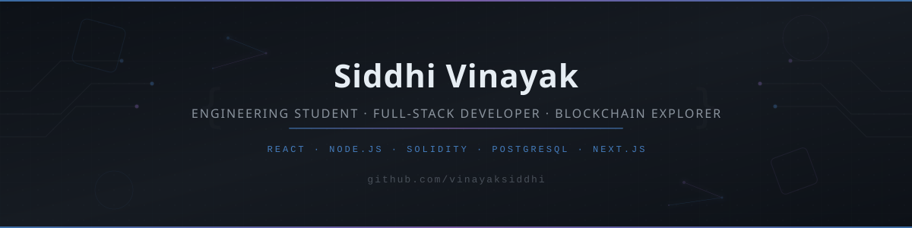

<!-- Profile Banner -->
<div align="center">
  
</div>

<div align="center">
  
  [](https://git.io/typing-svg)

</div>

<div align="center">
  
  [](https://github.com/vinayaksiddhi)
  [](https://www.linkedin.com/in/siddhi-vinayak-86784a386)

</div>

---

## 👋 About Me

I'm an **Electrical & Electronics Engineering** student at **BMS Institute of Technology and Management, Bengaluru**, with a strong pull toward software development.

I build full-stack web applications that address practical problems — jury evaluation platforms for hackathons, alumni networking systems with real-time messaging, and decentralized voting applications on the blockchain. My projects involve authentication flows, role-based access control, database design, real-time features, and smart contract integration — not just tutorial follow-alongs.

Currently, I'm deepening my understanding of **backend architecture**, **Data Structures & Algorithms in C++**, and **Solidity smart contracts**. I'm always looking to collaborate on projects where clean engineering matters more than just shipping fast.

---

## 🛠️ Technical Skills

### Languages
<p>
  
  
  
  
  
  
</p>

### Frontend
<p>
  
  
  
  
  
  
  
</p>

### Backend & Databases
<p>
  
  
  
  
  
  
</p>

### Blockchain & Web3
<p>
  
  
  
  
</p>

### Tools & Platforms
<p>
  
  
  
  
  
  
</p>

### Currently Exploring
<p>
  
  
  
</p>

---

## 🚀 Featured Projects

### 🏛️ Jury Evaluation Platform
> A premium real-time evaluation platform for hackathons, competitions, and jury-based events.

<table>
  <tr>
    <td width="50%">
      <strong>What it does:</strong> Enables judges to securely evaluate teams with weighted scoring, while admins monitor progress and reveal rankings through an animated leaderboard experience.
      <br/><br/>
      <strong>Key engineering:</strong>
      <ul>
        <li>Role-based authentication (Admin & Judge panels)</li>
        <li>Real-time scoring with draft save & final submission lock</li>
        <li>Cinematic animated leaderboard reveal with confetti</li>
        <li>CSV/PDF export, audit logs, and evaluation management</li>
        <li>PostgreSQL with Prisma ORM for data integrity</li>
      </ul>
    </td>
    <td width="50%">
      <strong>Built with:</strong><br/>
      
      
      
      
      
      
      <br/><br/>
      <strong>Status:</strong> ✅ Deployed<br/>
      <a href="https://jury-evaluation.vercel.app">🌐 Live Demo</a> · <a href="https://github.com/vinayaksiddhi/jury-evaluation">📂 Source Code</a>
    </td>
  </tr>
</table>

---

### 🗳️ DecentraVote — Decentralized Voting DApp
> A full-stack decentralized voting application with on-chain vote integrity and zero mocking.

<table>
  <tr>
    <td width="50%">
      <strong>What it does:</strong> A blockchain-native voting system where all candidate data, vote counts, and election status are read directly from the Solidity smart contract — no backend database, no faking.
      <br/><br/>
      <strong>Key engineering:</strong>
      <ul>
        <li>Solidity ^0.8.20 smart contract with one-vote-per-wallet EVM enforcement</li>
        <li>Real-time VoteCast event listener for live tally updates</li>
        <li>MetaMask wallet integration with automatic chain detection</li>
        <li>Full transaction lifecycle tracking (pending → submitted → confirmed → reverted)</li>
        <li>Owner-only admin panel for election management</li>
      </ul>
    </td>
    <td width="50%">
      <strong>Built with:</strong><br/>
      
      
      
      
      
      
      <br/><br/>
      <strong>Status:</strong> ✅ Complete (Hardhat Local Network)<br/>
      <a href="https://github.com/vinayaksiddhi/DecentraVote">📂 Source Code</a>
    </td>
  </tr>
</table>

---

### 🎓 ALUM-SPHERE — Alumni-Student Networking Platform
> A real-time alumni-student connection platform with mentorship matching and instant messaging.

<table>
  <tr>
    <td width="50%">
      <strong>What it does:</strong> Bridges the gap between students and alumni through dynamic matchmaking, WhatsApp-style real-time chat, project showcases, and collegiate Q&A discussions.
      <br/><br/>
      <strong>Key engineering:</strong>
      <ul>
        <li>Real-time messaging with Supabase Broadcast (sub-100ms delivery)</li>
        <li>Matchmaking engine based on college, department, and expertise</li>
        <li>Connection request system with automatic chat channel creation</li>
        <li>Optimistic UI with debounced WebSocket listeners</li>
        <li>Clerk authentication with role-based dashboards</li>
      </ul>
    </td>
    <td width="50%">
      <strong>Built with:</strong><br/>
      
      
      
      
      
      
      <br/><br/>
      <strong>Status:</strong> ✅ Complete<br/>
      <a href="https://github.com/vinayaksiddhi/ALUM-SPHERE">📂 Source Code</a>
    </td>
  </tr>
</table>

---

### 📅 Event Planner
> A web application for managing events and registrations.

<table>
  <tr>
    <td width="50%">
      <strong>What it does:</strong> An event management system for creating, organizing, and tracking events with registration workflows.
      <br/><br/>
      <strong>Key engineering:</strong>
      <ul>
        <li>Event creation and management interface</li>
        <li>Registration tracking workflows</li>
        <li>Deployed and accessible on the web</li>
      </ul>
    </td>
    <td width="50%">
      <strong>Built with:</strong><br/>
      
      
      <br/><br/>
      <strong>Status:</strong> ✅ Deployed<br/>
      <a href="https://event-planner-genk.vercel.app/">🌐 Live Demo</a> · <a href="https://github.com/vinayaksiddhi/event_planner">📂 Source Code</a>
    </td>
  </tr>
</table>

---

### 🔐 ProofVault — Document Integrity Platform *(Concept)*
> A blockchain-backed document verification and integrity platform.

**Direction:** Using PostgreSQL and Docker for document storage, with blockchain-based verification to ensure tamper-proof document integrity. This project explores how backend systems can integrate with blockchain to provide verifiable proof of document authenticity.

**Status:** 🔬 Concept / Early Development

---

## 📈 Development Journey

```
2024-present
│
├── Started with C++ fundamentals and algorithmic thinking
├── Built HTML/CSS/JavaScript projects and learned React
├── Progressed to full-stack development with Node.js & Express
├── Adopted Next.js, TypeScript, and PostgreSQL for production apps
├── Developed real-world evaluation and networking platforms
├── Explored Solidity and deployed smart contracts on Hardhat
└── Currently: Deepening DSA, backend architecture, and Web3
```

I approach learning by building things that work — not by collecting certificates. Each project above represents a real problem I identified and tried to solve with code.

---

## 🧠 DSA & Problem Solving

I practice Data Structures and Algorithms primarily in **C++**, focusing on building a strong foundation in algorithmic thinking and efficient problem-solving.

**Areas of focus:**
- Arrays, Strings, and Hashing
- Linked Lists and Trees
- Recursion and Dynamic Programming
- Sorting and Searching algorithms
- Graph algorithms

<!-- 
  📝 To add your LeetCode stats, uncomment the line below and replace YOUR_LEETCODE_USERNAME:
  [](https://leetcode.com/YOUR_LEETCODE_USERNAME)
-->

> *LeetCode profile link will be added once available.*

---

## ⛓️ Blockchain & Web3

I'm actively learning blockchain development with a focus on **Solidity** smart contracts and decentralized application architecture.

**What I'm working on:**
- Writing and deploying Solidity smart contracts
- Understanding EVM mechanics, gas optimization, and contract security
- Building frontend integrations with ethers.js and MetaMask
- Exploring document integrity and verification use cases (ProofVault concept)
- Studying how traditional backend systems can interface with blockchain networks

**DecentraVote** is my most complete blockchain project — a fully functional voting DApp where every vote is recorded on-chain with EVM-level enforcement against double voting.

> I'm looking for collaborators interested in Web3 development, smart contract design, and decentralized application architecture.

---

## 📊 GitHub Statistics

<div align="center">
  
  
</div>

<div align="center">
  
</div>

<div align="center">
  
</div>

---

## 🏛️ Experience & Community

**IEEE Computer Society — Technical Team**
- Contributed to technical operations and event coordination
- Built tools for hackathon evaluation workflows (Jury Evaluation Platform)
- Participated in event planning and team coordination during technical events
- Developed practical software solutions for real IEEE event requirements

**Hackathon Development**
- Built and deployed evaluation platforms used during actual events
- Worked on team coordination tools and registration systems
- Experience designing scoring criteria, role-based access, and real-time leaderboard systems

> These are extracurricular and project experiences connected to my engineering studies — not formal employment.

---

## 🎯 Current Focus

- 📚 **Data Structures & Algorithms** — Strengthening problem-solving skills in C++
- 🏗️ **Full-Stack Development** — Building reliable, production-grade web applications
- 🗄️ **Backend Architecture** — Designing scalable APIs and database schemas
- ⛓️ **Solidity & Smart Contracts** — Writing secure, gas-efficient smart contracts
- 📐 **System Design** — Understanding scalable system architecture patterns
- 🤝 **Open Source** — Contributing to meaningful software projects

---

## 🤝 Connect With Me

<div align="center">

  [](https://github.com/vinayaksiddhi)
  [](https://www.linkedin.com/in/siddhi-vinayak-86784a386)
  <!-- Add email badge when ready: [](mailto:your@email.com) -->

</div>

<div align="center">
  <br/>
  <em>I'm open to collaborating on full-stack web applications, blockchain projects, developer tools, and open-source initiatives.</em>
  <br/>
  <em>If you're working on something interesting, let's connect.</em>
</div>

---

<div align="center">
  
  <br/><br/>
  <sub>Built with care. Accuracy over aesthetics. Projects over promises.</sub>
</div>
